# StreamAI Studio

Aplicación para Windows que transmite en vivo a varias plataformas a la vez e incluye un host de IA para el chat de Twitch y Kick.

[](https://github.com/santo29/streamai-downloads/releases/latest)

StreamAI Studio es gratuito y de código cerrado. Este repositorio contiene los instaladores, las capturas, las notas de cada versión y la licencia. El código fuente no es público.

## Descargas

| Plataforma | Requisitos | Enlace |
|---|---|---|
| Windows | Windows 10 u 11 de 64 bits | [StreamAI-Studio-Windows-Setup.exe](https://github.com/santo29/streamai-downloads/releases/latest/download/StreamAI-Studio-Windows-Setup.exe) |
| Android | Android 7.0 o superior | [StreamAI-Studio-Android.apk](https://github.com/santo29/streamai-downloads/releases/latest/download/StreamAI-Studio-Android.apk) |
| Navegador | Chrome recomendado | [streamai-studio-db.web.app](https://streamai-studio-db.web.app) |

El instalador de Windows no tiene firma digital, así que Windows SmartScreen seguirá mostrando un aviso al instalarlo.

La versión completa es la de Windows, porque incluye el motor de transmisión local con FFmpeg. La versión web y el APK sirven para probar el estudio, pero no transmiten a las plataformas ni responden el chat con IA.

## Problemas conocidos en la versión 1.8.2

La descarga actual sigue siendo la versión 1.8.2. Las funciones y capturas de esta página corresponden a la 1.9.0, ya preparada y pendiente de publicar. Estos fallos de la 1.8.2 están corregidos en la 1.9.0:

- Host de IA en Kick: no recibe mensajes, porque Kick cambió su sistema de chat. En Twitch sí funciona.
- Coste de la IA: en un chat activo la app hace una llamada al proveedor por cada mensaje, sin límite, y puede agotar tu saldo rápido.
- Errores de la IA: si el proveedor rechaza la clave o no responde, la app no lo muestra.
- Google Gemini: el modelo predeterminado de la app ya no existe, así que no responde.
- Clonar Pantalla: se transmite sin el sonido del equipo, así que el juego no se oye.
- Clips automáticos: no arrancan. Al pulsar Inicializar Módulo aparece un aviso de error.
- Micrófono: la cámara lo abre aunque el control diga apagado. Si lo activas en pleno directo, no se oye hasta la siguiente transmisión.
- Claves de transmisión: aparecen en el registro de Logs & Diagnóstico. No muestres esa pantalla a nadie.
- Mesa de Audio: los controles de Micrófono y Master Out no afectan al Motor de Streaming.
- Panel principal: muestra datos que no son reales, como la licencia, el consumo de tokens y la latencia. La tienda muestra compras sin efecto.

## Funciones

Capturas de la versión 1.9.0 con datos de ejemplo.

### Transmisión en vivo

Compone la imagen y la envía por RTMP o RTMPS. La fuente puede ser la pantalla, una ventana, un video, una imagen o una capturadora.

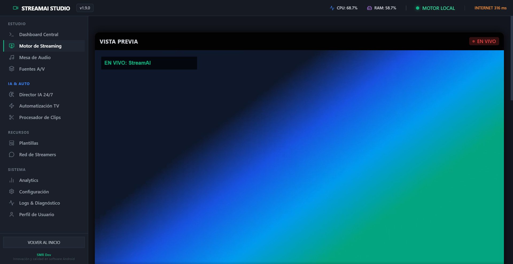

### Varios destinos

Activa más plataformas, cada una con su clave y su servidor. Si un destino falla, los demás siguen en vivo.

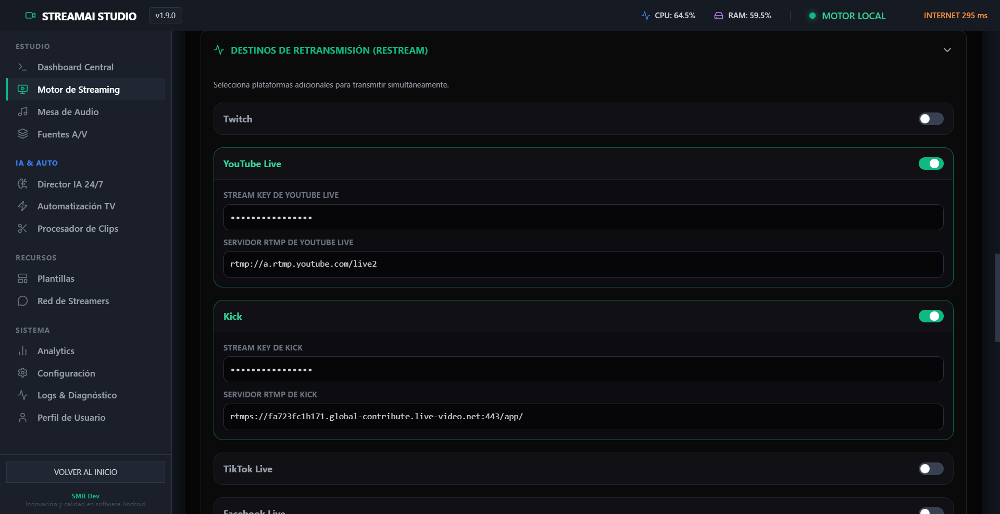

### Panel principal

Muestra si estás en vivo, el tiempo de transmisión y el consumo de CPU y RAM.

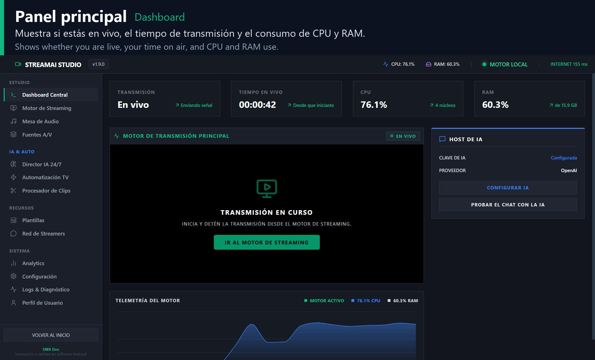

### Vincular canales

Enlaza tus canales. Twitch y Kick se conectan con el host de IA; las demás plataformas quedan en tu perfil.

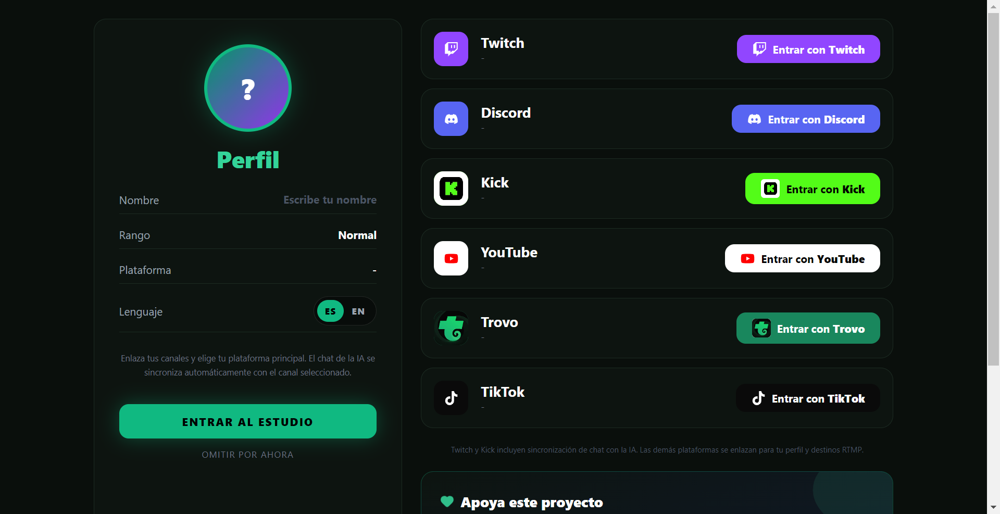

### Host de IA

Lee el chat de Twitch y Kick y responde con tu propia clave. Solo actúa con el Auto-Host encendido y hace como máximo una llamada a la IA cada 8 segundos.

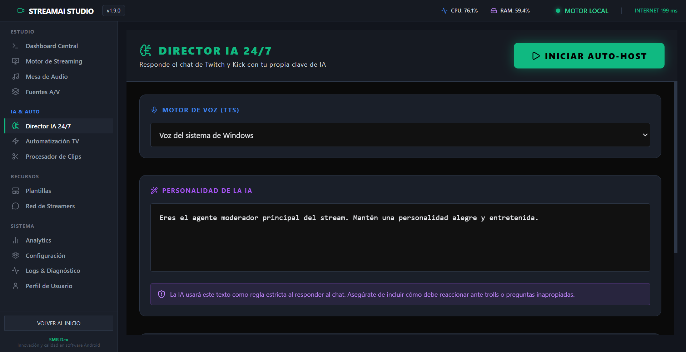

### Configuración de IA

Elige OpenAI, Anthropic o Google Gemini, pega tu clave y, si quieres, indica el modelo. La voz de ElevenLabs es opcional.

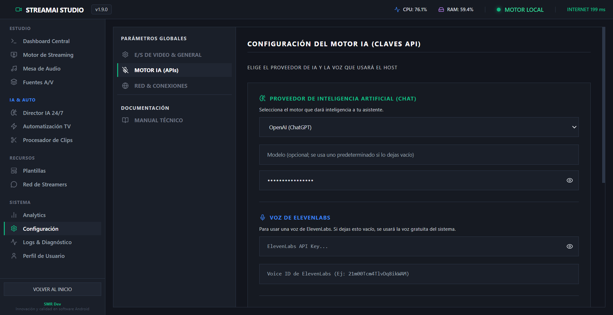

### Clips automáticos

Guarda cerca de 30 segundos de video cuando sube el volumen o llegan seis mensajes de chat en cuatro segundos. Los clips se exportan en WebM.

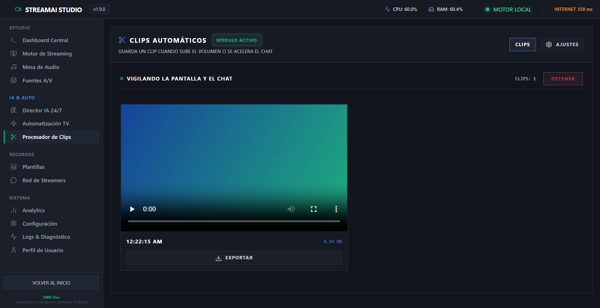

### Filtros y lentes

Aplica 20 filtros de video, 8 lentes con seguimiento facial, lentes creados a partir de una imagen y lentes de Snapchat.

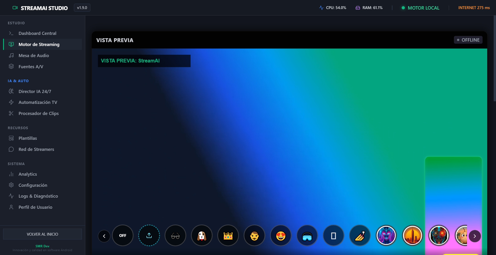

### Plantillas

Dibuja sobre la transmisión etiquetas, marcadores, marcos o un banner con tu texto y tu color.

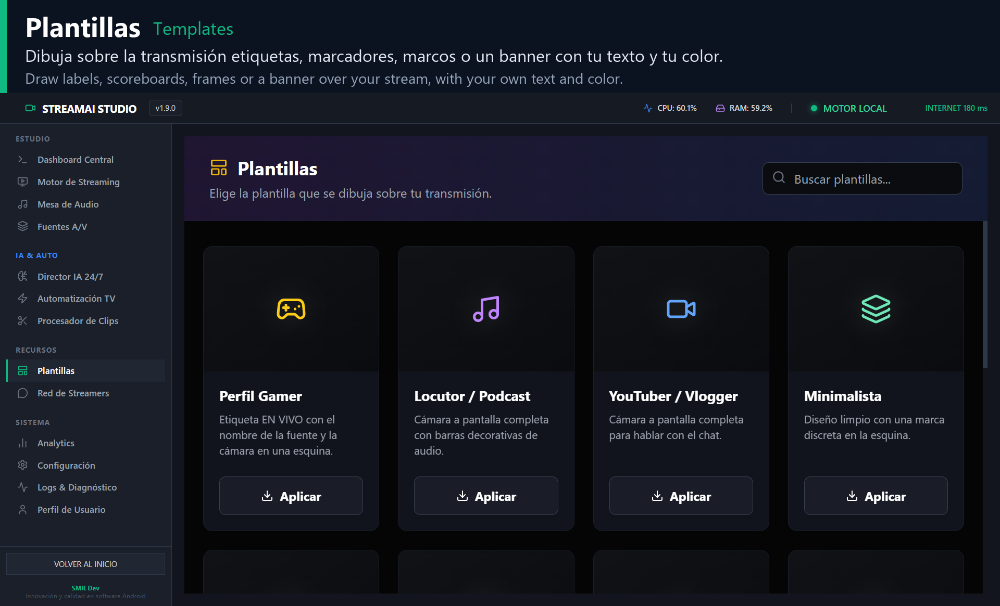

### Mesa de Audio

Ajusta el nivel del micrófono y el volumen general del directo, y lanza efectos de sonido que también oyen tus espectadores.

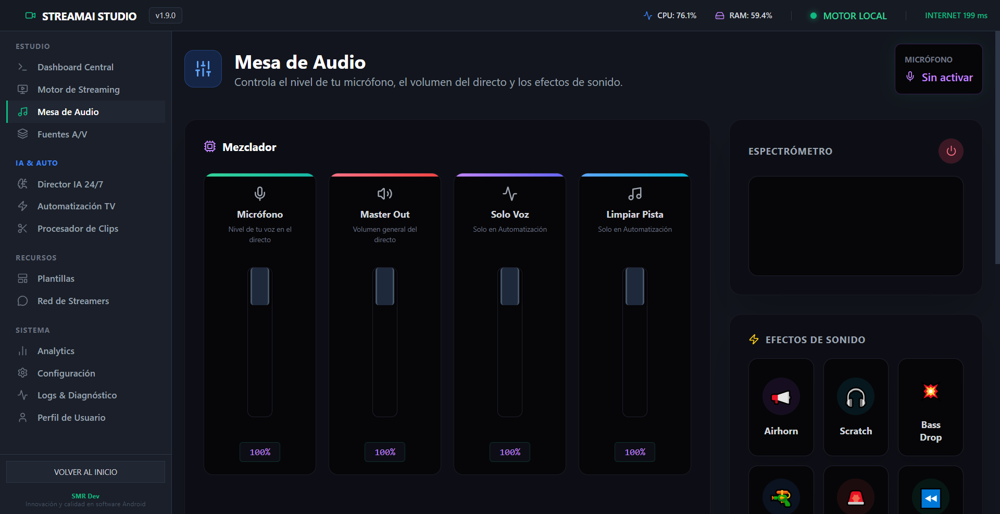

### Automatización de video

Reproduce en bucle una lista de videos MP4 o WebM hacia tus destinos, mientras la app esté abierta.

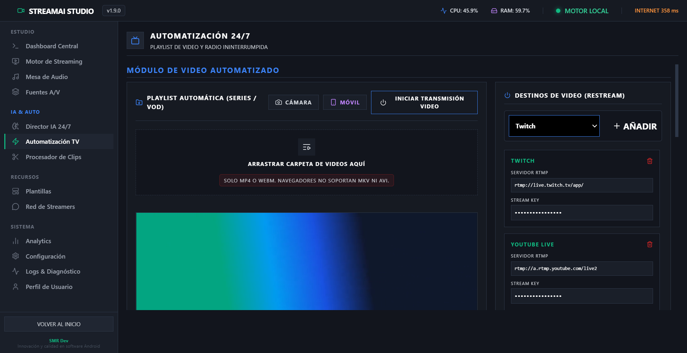

### Radio 24/7

Transmite archivos de audio con una imagen de portada, o retransmite una emisora en vivo (Icecast, Shoutcast o HLS).

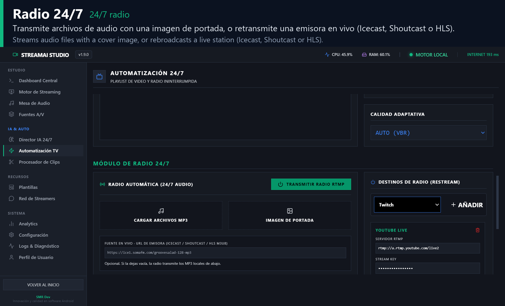

### Diagnóstico

Muestra el consumo del equipo, el codificador en uso (GPU o CPU) y el registro del motor. Las claves de transmisión no aparecen en el registro.

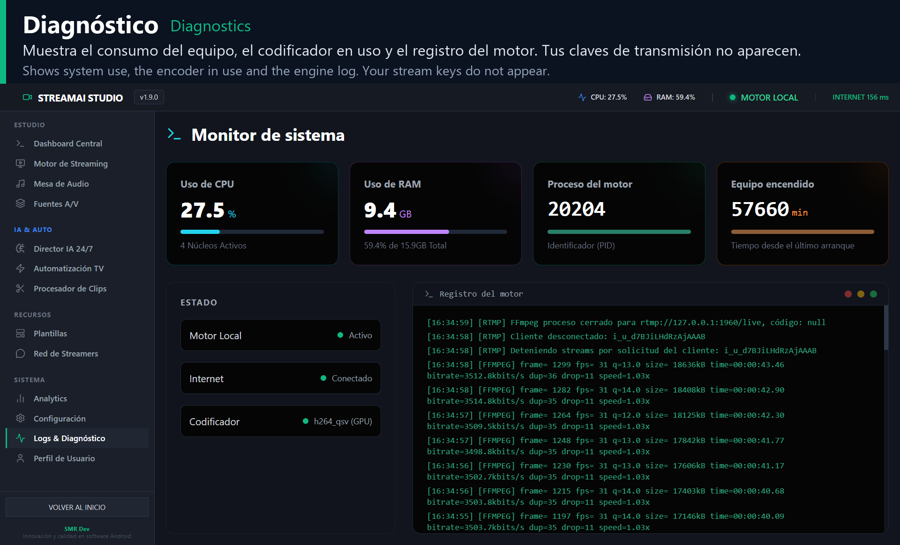

## Instalación en Windows

1. Descarga `StreamAI-Studio-Windows-Setup.exe`.
2. Abre el instalador. Si aparece Windows SmartScreen, elige Más información y luego Ejecutar de todas formas. En Windows 11 con Smart App Control activado, Windows puede bloquear el instalador porque no está firmado.
3. Elige la carpeta de instalación y termina el asistente.

## Primeros pasos

Para transmitir:

1. Abre Motor de Streaming, elige la plataforma principal y pega su Stream Key. Puedes activar más destinos con sus propias claves.
2. Si la dirección predefinida de una plataforma no funciona, pega la URL del servidor que aparece en su panel. TikTok, Kick, Instagram, X, Rumble y Vimeo suelen asignar una propia.
3. Elige una fuente con Clonar Pantalla o en Fuentes A/V.
4. Activa el micrófono si quieres que se oiga tu voz. Viene apagado por defecto.
5. Pulsa Iniciar Stream. Kick exige activar la verificación en dos pasos en tu cuenta.

Para usar el host de IA:

1. En Configuración, abre Motor IA (APIs), elige el proveedor, pega tu clave y guarda.
2. En Perfil de Usuario, vincula tu canal de Twitch o Kick.
3. Abre Director IA 24/7 y pulsa Iniciar Auto-Host.

Cada respuesta consume saldo de tu proveedor de IA, según sus condiciones y precios. Para que la IA escriba en el chat debes crear una aplicación de desarrollador en Twitch o Kick y autorizarla desde la app. Sin ese paso, las respuestas no se publican en el chat.

## Limitaciones conocidas

- Subtítulos en vivo: no funcionan en la app de Windows, porque el servicio de voz falla siempre. Solo responden en la versión web con Chrome, que no transmite a las plataformas.
- Red de Streamers: se puede leer, pero no publicar.
- APK de Android: sigue siendo el de la versión 1.6.0. No transmite ni responde el chat con IA.
- Voz del host de IA: suena en tus altavoces y no entra en la mezcla del directo. Solo pueden oírla tus espectadores si compartes pantalla con Clonar Pantalla, que en la versión 1.9.0 captura el sonido del equipo.
- Chat de Kick: la app lo lee desde su página pública. Si Kick cambia su sistema, puede dejar de funcionar; en ese caso la app lo avisa.

## Estado de las pruebas

La versión 1.9.0 se probó en un Intel Core i3-8130U con Windows 10, usando un servidor RTMP local, cámara y micrófono simulados, un proveedor de IA simulado y los chats públicos de Twitch y Kick en solo lectura.

Sin probar todavía: transmitir a cuentas reales, claves reales de OpenAI, Anthropic, Google Gemini y ElevenLabs, publicar respuestas en el chat, una cámara y un micrófono físicos, los lentes faciales con un rostro real y Windows 11.

## Rendimiento

Medición del autor en un Intel Core i3-8130U de 2 núcleos con gráficos UHD 620, a 1080p30 y 6 Mbps contra una ingesta RTMP real:

| Codificador | Velocidad | CPU del codificador |
|---|---|---|
| libx264 (software) | 0.89x | 50.5 % |
| h264_qsv (GPU) | 1.00x | 15.6 % |

La prueba con GPU duró 11 minutos, sin fotogramas perdidos. La señal RTMP se limita a 1440p y 9 Mbps. En reposo, en el Motor de Streaming, la versión 1.9.0 usa entre 8 % y 10 % de la CPU en ese mismo equipo; la 1.8.2 usa entre 41 % y 42 %. Los resultados pueden variar en otros equipos.

## Privacidad

Las claves se guardan en el equipo, cifradas con una clave derivada del dispositivo. Es una protección básica: evita la lectura casual, pero no resiste a un atacante con acceso al equipo. Estos datos salen del equipo:

- Con el Auto-Host encendido, los mensajes del chat y tu clave van al proveedor de IA que elijas.
- Las respuestas van a ElevenLabs, solo si configuras esa voz.
- Si activas los subtítulos en la versión web, tu voz va al servicio de reconocimiento del navegador y el texto a Google Translate.
- Red de Streamers lee sus mensajes desde Firebase.
- La app consulta la API de GitHub al iniciar y cada 6 horas para buscar actualizaciones.
- Al vincular un canal de Twitch, la app lo verifica con el servicio decapi.me.

En la versión 1.9.0 el micrófono está apagado por defecto y la cámara no lo abre. Solo se activa si lo enciendes y das permiso.

## Verificar las descargas

Las notas de cada [versión](https://github.com/santo29/streamai-downloads/releases) incluyen el SHA-256 de cada archivo. Para comprobarlo en PowerShell:

```powershell
Get-FileHash .\StreamAI-Studio-Windows-Setup.exe -Algorithm SHA256
```

También puedes analizar el archivo en [VirusTotal](https://www.virustotal.com) antes de instalarlo. Un programa sin firma digital puede dar algún falso positivo aislado.

## Uso responsable

Transmitir a varias plataformas a la vez, los canales automatizados 24/7 y usar música con copyright pueden chocar con los términos de Twitch, YouTube, TikTok y Kick, y con los derechos de autor. Algunas plataformas exigen un mínimo de seguidores para dar acceso a RTMP o desincentivan el contenido totalmente automático. Tú eres responsable de tus cuentas, así que revisa las reglas de cada plataforma.

## Licencia

StreamAI Studio es freeware y se entrega sin garantía. Consulta [LICENSE](LICENSE) y [TERMS.md](TERMS.md). Los componentes de terceros conservan sus licencias, listadas en [THIRD_PARTY_NOTICES.md](THIRD_PARTY_NOTICES.md).

## Soporte

Puedes informar de errores en [Issues](https://github.com/santo29/streamai-downloads/issues). Si el proyecto te resulta útil, puedes darle una estrella o hacer una [donación por PayPal](https://www.paypal.com/donate/?business=rodriguezsanto17%40gmail.com&no_recurring=0&currency_code=USD&item_name=Apoyo%20a%20StreamAI%20Studio).

Desarrollado por Santo Montilla ([santo29](https://github.com/santo29)) en República Dominicana.

<details>
<summary>English</summary>

StreamAI Studio is a free, closed-source Windows app for streaming to several platforms at once over RTMP. It includes an AI host for Twitch and Kick chat that uses your own OpenAI, Anthropic or Google Gemini key. It also offers automatic clips, video filters and face lenses, overlays, an audio mixer, 24/7 playlists and radio, and GPU encoding.

Live captions do not work in the Windows app. The web version and the Android APK let you try the studio, but they do not stream or answer chat with AI. The installer is not digitally signed, so Windows SmartScreen will show a warning. See [LICENSE](LICENSE) for the terms of use, which are in Spanish.

</details>
